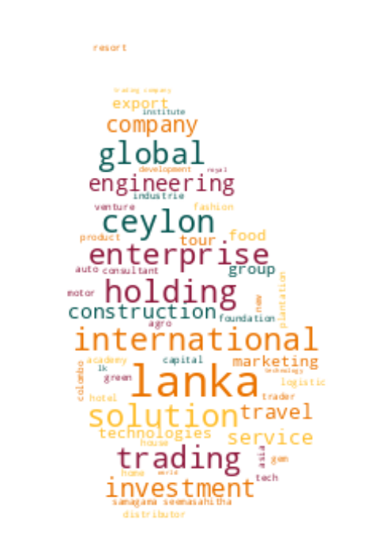
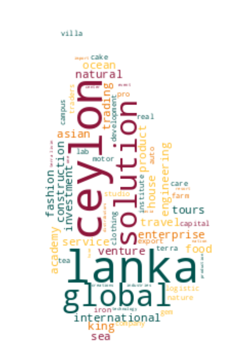
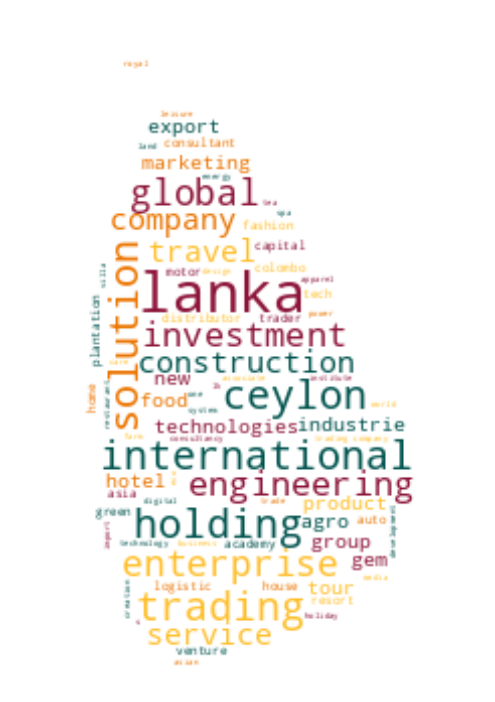
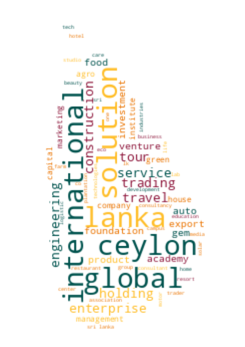
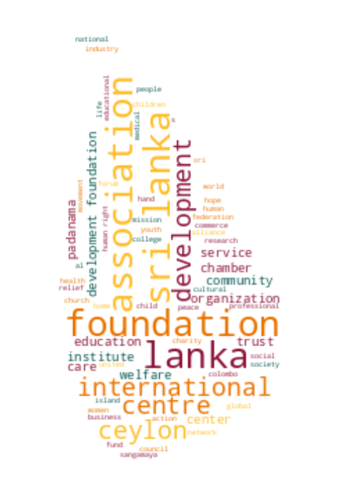
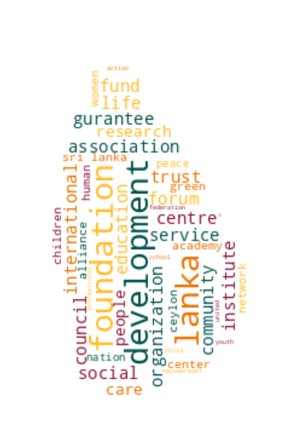
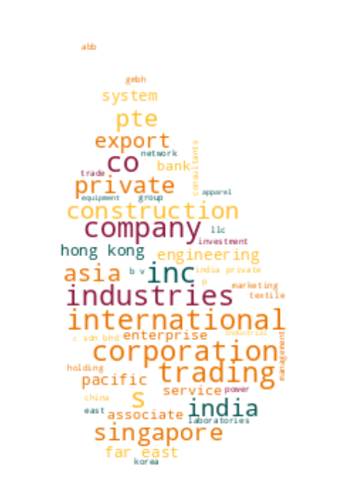
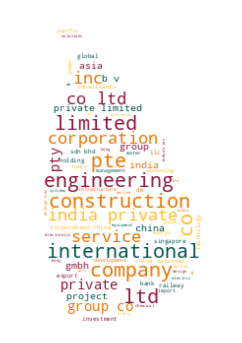
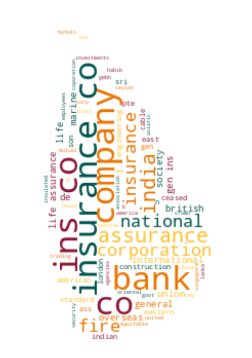

# Registrar of Companies - Sri Lanka

Data Scraped from Registrar of Companies - Sri Lanka (https://eroc.drc.gov.lk)

Scraped **164,653** Companies ([5.07MB](data/companies.tsv)) as of *2026-11-25 10:10:59*.

*Scraping Progress: 52,728/52,728*
✅✅✅✅✅✅✅✅✅✅

## Selection of Companies
*Sample of 10/164653*

* (1) PCC00287821 - **99X TECHNOLOGY AS**
* (18,295) PV00255309 - **BLUPOWER INDUSTRIAL SOLUTIONS**
* (36,590) PV00285079 - **DIGITUS TEC**
* (54,885) PV00202149 - **GRAND ELISABETH HOTEL**
* (73,179) PV107 - **KIMBERLEY HOTELS AND RESORTS**
* (91,474) PV00283407 - **MULTY MOBILE**
* (109,769) PV68495 - **PRISM GROUP HOLDINGS**
* (128,063) PV00251113 - **SEVEN SEAS FISHERIES**
* (146,358) PV00282262 - **THE ROJAR TRADER**
* (164,653) PV118576 - **ZZAPPIT**

## Latest 1,000 Companies
*Sample of 10/1000*

* (1) PV00364621 - **ASELA AUTO ZONE**
* (112) PV00365508 - **POV INTERNATIONAL**
* (223) PV00366535 - **MAGAMPURA SAHAL**
* (334) PV00367662 - **YOLICO CONFECTIONERY**
* (445) PV00368696 - **IRON LION SECURITY**
* (556) PV00369972 - **NATIONS SKILLS DEVELOPMENT CAMPUS**
* (667) PV00371681 - **MAXX OUTFIT**
* (778) PV00373661 - **FASHION SPARK LANKA**
* (889) PV00376107 - **SRI KAASA GREEN LANKA**
* (1,000) PV00381488 - **SRI MINDARA CONSTRUCTION**

## Selection for Companies by Type

### "PV"
*Sample of 10/149656*

* (1) PV20853 - **A AND A ASSOCIATES**
* (16,629) PV00226588 - **BLUECHEM LANKA**
* (33,257) PV00318491 - **DIGITAL TECH LABS**
* (49,886) PV5122 - **GOOD SPIRIT CO.**
* (66,514) PV00314309 - **KER EKATAH**
* (83,142) PV00201021 - **MOTHER'S COMFORT**
* (99,771) PV00242459 - **PREMIUM BEVERAGES MART**
* (116,399) PV60682 - **SEWANIMA DISTRIBUTORS**
* (133,027) PV00202886 - **THE TEA TREE RESORT & SPA**
* (149,656) PV118576 - **ZZAPPIT**

### ""
*Sample of 10/6515*

* (1)  - **A BRAND HOLDINGS**
* (724)  - **BLOOMING ACRES**
* (1,448)  - **DHARMAWARDHANA CONSTRUCTIONS**
* (2,172)  - **GREEN AURA HERITAGE**
* (2,896)  - **KING COLOMBO**
* (3,619)  - **NAGERAN**
* (4,343)  - **PRO SOUND TECHNOLOGIES**
* (5,067)  - **SIGN TECH SOLUTIONS**
* (5,791)  - **TIFFANY CHAIRS LANKA**
* (6,515)  - **ZYPHER CLOUD**

### "PB"
*Sample of 10/2926*

* (1) PB5111 - **A ONE TOP TRADING**
* (326) PB977 - **CEYSAND RESORTS**
* (651) PB627 - **HAYLEYS CONSUMER PRODUCTS**
* (976) PB773 - **MERCANTILE FINANCIAL SERVICES**
* (1,301) PB5391 - **SAVI ABHIMANI COMPANY**
* (1,626) PB1362 - **SEEMASAHITHA (JANATHA) MAYURAGAMA GAMIDIRIYA SAMAGAMA (NEPV (P) 642)**
* (1,951) PB4231 - **SEEMASAHITHA DADUHETHEPMA GAMANEGUMA JANATHA SAMAGAMA**
* (2,276) PB4727 - **SEEMASAHITHA NAHAWILA WATTA GAMANEGUMA JANATHA SAMAGAMA**
* (2,601) PB5176 - **SIMAMTA CAPITAL**
* (2,926) PB118 - **ZYREX POWER COMPANY**

### "GA"
*Sample of 10/2858*

* (1) GA00321009 - **A HAND OF HOPE**
* (318) GA00263945 - **BARAKAH CHARITY**
* (635) GA3066 - **CONSTRUCTION INDUSTRY SKILLS COUNCIL**
* (953) GA92 - **GRASSROOTS FOUNDATION**
* (1,270) GA00211470 - **JERUSHIYA  FOUNDATION**
* (1,588) GA2461 - **MIHISARA DEVELOPMENT FOUNDATION**
* (1,905) GA00257241 - **PROFESSIONAL BUSINESS COACHES ASSOCIATION (PBCA)**
* (2,223) GA00235752 - **SMILE ISLAND**
* (2,540) GA00279519 - **THE DELMON FOUNDATION**
* (2,858) GA470 - **ZONTA CLUB II OF COLOMBO**

### "GL"
*Sample of 10/939*

* (1) GL00223389 - **A LITTLE  FOUNDATION**
* (105) GL00257153 - **AZ ZAHRA ASSOCIATION**
* (209) GL00261912 - **DILIGANZ TRUST**
* (313) GL2346 - **GREEN VISVA LANKA FARM DEVELOPERS**
* (417) GL00363869 - **JESUS FAMILY MISSION**
* (522) GL00255293 - **MIRELLY OUTREACH FUND FOR CHILDREN**
* (626) GL2334 - **RAKUNO JAPAN**
* (730) GL00234768 - **SIVATHARMA MAHABODHI ATHEENAM**
* (834) GL2404 - **TRANSDEV LANKA**
* (939) GL2310 - **ZOE LIFE INTERNATIONAL (GURANTEE)**

### "NF"
*Sample of 10/547*

* (1) NF137 - **AB FINLANKA**
* (61) NF200 - **BRAUN MEDICAL INDUSTERIES SDN BHD**
* (122) NF182 - **EDEN TOYS INC.**
* (183) NF20 - **HERMES SHIPPING AND TRANSPORT**
* (243) NF317 - **KOREA HEAVY INDUSTRIES AND CONSTRUCTION CO.**
* (304) NF278 - **MY INTERNATIONAL CO.**
* (365) NF597 - **PRACTICAL ACTION**
* (425) NF108 - **SKY TRACK LMITED**
* (486) NF80 - **TOMEN HOTLINE (HONG-KONG)**
* (547) NF711 - **ZTE CORPORATION**

### "FC"
*Sample of 10/402*

* (1) FC00251549 - **AA JAPAN (PVT) LTD**
* (45) FC1044 - **BIS VAM ANLAGENTECHNIK GMBH**
* (90) FC1253 - **CONTROL PRINT**
* (134) FC1191 - **GARAMSPACE COMPANY**
* (179) FC1244 - **JAPAN AIRPORT CONSULTANTS, INC.**
* (223) FC1263 - **MASTERCARD SINGAPORE HOLDING PTE.**
* (268) FC1228 - **OTT HYDROMET GMBH**
* (312) FC00211497 - **SBT CO., LTD.**
* (357) FC00247605 - **THE WESTMINSTER FOUNDATION FOR DEMOCRACY LIMITED**
* (402) FC1444 - **ZIFAM PINNACLE PTY LTD**

### "F"
*Sample of 10/232*

* (1) F234 - **ALCO INSURANCE COMPANY**
* (26) F87 - **BRITISH EQUITABLE ASS CO.**
* (52) F318 - **ENGINEERING CONSTRUCTION CORPORATION**
* (78) F322 - **HYOSUWG CORPORATION**
* (103) F304 - **MALAYAON AIR WAYS**
* (129) F376 - **ORIENTA CONSULTANT INVESTMENTS CO**
* (155) F49 - **SCOTTISH UNION NATIONAL INSURANCE CO.**
* (180) F285 - **TERRAVER V MICHAEL**
* (206) F250 - **THE PIONERR FIRE & GEN INS CO**
* (232) F6 - **YORKSHIRE INSURANCE CO LTC CEASED 1/11/70**

### "PQ"
*Sample of 10/177*

* (1) PQ188 - **ABANS ELECTRICALS**
* (20) PQ25 - **BROWN AND COMPANY**
* (40) PQ71 - **COLOMBO CITY HOLDINGS**
* (59) PQ53 - **EQUITY SEVEN**
* (79) PQ185 - **INDUSTRIAL ASPHALTS (CEYLON)**
* (98) PQ179 - **LANKA IOC**
* (118) PQ39 - **OVERSEAS REALTY (CEYLON)**
* (137) PQ192 - **SAMSON INTERNATIONAL**
* (157) PQ84 - **THE AUTODROME**
* (177) PQ181 - **YORK ARCADE HOLDINGS**

### "PCC"
*Sample of 10/98*

* (1) PCC00287821 - **99X TECHNOLOGY AS**
* (11) PCC00320558 - **ASCENT GLOBAL SOLUTIONS LIMITED**
* (22) PCC00285477 - **CHINA HARBOUR ENGINEERING COMPANY LIMITED**
* (33) PCC00324835 - **ENTERPRISE ANALYTICS LANKA (PVT) LTD.**
* (44) PCC00297858 - **HEXAWARE TECHNOLOGIES SL (PRIVATE) LIMITED.**
* (54) PCC00332631 - **INTERVEST GLOBAL DELIVERY (PRIVATE) LIMITED.**
* (65) PCC00298024 - **MITRA INNOVATION (AMERICAS) INC.**
* (76) PCC00300472 - **PATHFINDER GLOBAL FZCO**
* (87) PCC00284610 - **SATGURU TRAVEL AND TOURISM LLC**
* (98) PCC00292982 - **YOULANKA GROUP LIMITED**

### "PBPV"
*Sample of 10/92*

* (1) PB1296PV - **A BAUR AND COMPANY  TRAVEL**
* (11) PB162PV - **ASSETLINE INSURANCE BROKERS**
* (21) PB1567PV - **CYRIL GARDINER**
* (31) PB98PV - **FINLAY AIRLINE AGENCIES**
* (41) PB753PV - **HAYLEYS AVENTURA**
* (51) PB283PV - **KINGS COLLEGE**
* (61) PB382PV - **NATURE HOLDINGS**
* (71) PB854PV - **RENUKA AGRO EXPORTS**
* (81) PB3798PV - **TOKYO CEMENT POWER (LANKA)**
* (92) PB144PV - **WORLD SUBSEA SERVICES**

### "PVPB"
*Sample of 10/57*

* (1) PV4158PB - **ADAM CARBONS**
* (7) PV75497PB - **CAPITAL TRUST HOLDINGS**
* (13) PV5851PB - **CONSOLIDATED BUSINESS SYSTEMS**
* (19) PV118379PB - **FUTURE LIFE INVESTMENTS**
* (25) PV64818PB - **JANATHA CAPITAL INVESTMENTS**
* (32) PV69307PB - **NATURE'S BEST INDUSTRY**
* (38) PV16876PB - **PELWATTA DAIRY INDUSTRIES**
* (44) PV64641PB - **SOUTH ASIAN INSTITUTE OF TECHNOLOGY AND MEDICINE**
* (50) PV3822PB - **SWARNAMAHAL JEWELLERS**
* (57) PV77431PB - **WELIGAMA HOTEL PROPERTIES**

### "PBG"
*Sample of 10/46*

* (1) PBG45 - **ACCOUNTANCY ASSOSICATES**
* (6) PBG48 - **BRIGHTSTAR FINANCE**
* (11) PBG37 - **CONSULTANCY AND FINANCE AND DEVELOPMENT**
* (16) PBG22 - **FREE LANKA SPORTSMEN**
* (21) PBG9 - **OVERSEA CHILDRENS SCHOOL LTD ( BY GUARANTEE)**
* (26) PBG35 - **SAMPATH SPORTSMEN**
* (31) PBG17 - **THE BENEFIT PROVIDENT FUND**
* (36) PBG16 - **THE INSURANCE POLICY HOLDERS SERVICES**
* (41) PBG39 - **THEEPAM INSTITUTE**
* (46) PBG14 - **UNITED SPORTSMAN**

### "PBPQ"
*Sample of 10/30*
* (1) PB3618PQ - **AMANA BANK**
* (4) PB139PQ - **ASIA ASSET FINANCE**
* (7) PB3259PQ - **BIMPUTH LANKA INVESTMENTS**
* (10) PB633PQ - **DFCC VARDHANA BANK**
* (13) PB965PQ - **HNB FINANCE**
* (17) PB3754PQ - **PEOPLE'S  INSURANCE**
* (20) PB62PQ - **SANASA DEVELOPMENT BANK**
* (23) PB917PQ - **SIYAPATHA FINANCE**
* (26) PB689PQ - **TESS AGRO**
* (30) PB4242PQ - **WASKADUWA BEACH RESORT**

### "NPVS"
*Sample of 10/29*
* (1) NPVS40803 - **ALNA WATER SYSTEMS**
* (4) NPVS22400 - **CEETEE INTERNATIONAL**
* (7) NPVS35441 - **DUMBARA FERTILIZERS**
* (10) NPVS15104 - **FIVE STAR EXPORTS**
* (13) NPVS42442 - **HERITAGE SAPPHIRES**
* (16) NPVS38695 - **MCMILLAN CEYLON MARKETING**
* (19) NPVS9611 - **Q-NET**
* (22) NPVS18562 - **SERENDIB INSURANCE BROKERS**
* (25) NPVS11267 - **SILVER SHRIMPS**
* (29) NPVS16673 - **WESTERN TRADING COMPANY**

### "PVPBPQ"
*Sample of 10/13*
* (1) PV5301PBPQ - **ABANS**
* (2) PV3562PB/PQ - **ASIA SIYAKA COMODITIES**
* (3) PVPB13254PQ - **JETWING SYMPHONY**
* (5) PVPB7385PQ - **LOTUS HYDRO POWER**
* (6) PV9346PBPQ - **ORIENT GARMENTS**
* (7) PV9959PBPQ - **PANASIAN POWER**
* (9) PVPB8234PQ - **RAMBODA FALLS**
* (10) PV415PBPQ - **RESUS ENERGY**
* (11) PV70371PB/PQ - **SINGHE HOSPITALS**
* (13) PV7617PBPQ - **TEEJAY LANKA**

### "PQPB"
* (1) PQ96PB - **ASIRI CENTRAL HOSPITALS**
* (2) PQ15PB - **ASSOCIATED ELECTRICAL CORPORATION**
* (3) PQ17PB - **ASSOCIATED PROPERTY DEVELOPMENT**
* (4) PQ193PB - **BERUWELA WALK INN**
* (5) PQ99PB - **CEYLON LEATHER PRODUCTS**
* (6) PQ19PB - **EQUITY ONE**
* (7) PQ176PB - **KURUWITA TEXTILE MILLS**
* (8) PQ220PB - **METROPOLITAN RESOURCE HOLDINGS**
* (9) PQ77PB - **MORISON**

### "OC"
* (1) OC111 - **ASTER JETFUEL**
* (2) OC108 - **CAMSO TRADING**
* (3) OC109 - **ENERGY COMMERCE B.V.**
* (4) OC110 - **GLOBAL SOFT TECHNOLOGIES**
* (5) OC104 - **MERCANTILE SEASCAPE SHIPPING COMPANY**
* (6) OC106 - **MERCANTILE SEAWIND SHIPPING COMPANY**
* (7) OC103 - **MERCANTILE SEBORNE SHIPPING**
* (8) OC102 - **POWER HUB INTERNATIONAL SDN PHD**

### "PVS"
* (1) PVS1795 - **CINE-TECH**
* (2) PVS8467 - **LAKMINI ENTERPRISES**
* (3) PVS7888 - **RADIAN PRODUCTS**
* (4) PVS7498 - **WINGS TRAVELS AND TOURS**
* (5) PVS8227 - **WOODLANDS LANKA**

### "PVPQ"
* (1) PV10527PQ - **ADAM CAPITAL**
* (2) PV1618PQ - **AGSTAR**
* (3) PV72355PQ - **ANILANA HOTELS & PROPERTIES**

### "PBPVPB"
* (1) PB64PVPB - **GAC SHIPPING**
* (2) PB553PV/PB - **INTERNATIONAL CONSUMER BRANDS**
* (3) PBPVPB138 - **MCLARENS SHIPPING**

### "PQPBPV"
* (1) PQ98PBPV - **ACE POWER GENERATION MATARA**
* (2) PQ16PB/PV - **ASSOCIATED MOTORWAYS**

### "NFA"
* (1) NF160A - **CO ECHO ENTERPRISES**

### "PBPQPB"
* (1) PB613PQ/PB - **JANASHAKTHI**

### "GAGL"
* (1) GA683GL - **LANKA PRISON FELLOWSHIP**

### "CIA"
* (1) CIA389 - **REFINITIV**

### "PBpv"
* (1) PB1236pv - **UNILEAVER CEYLON SERVICES**

### "PQPV"
* (1) PQ231PV - **UNION RESORTS**
